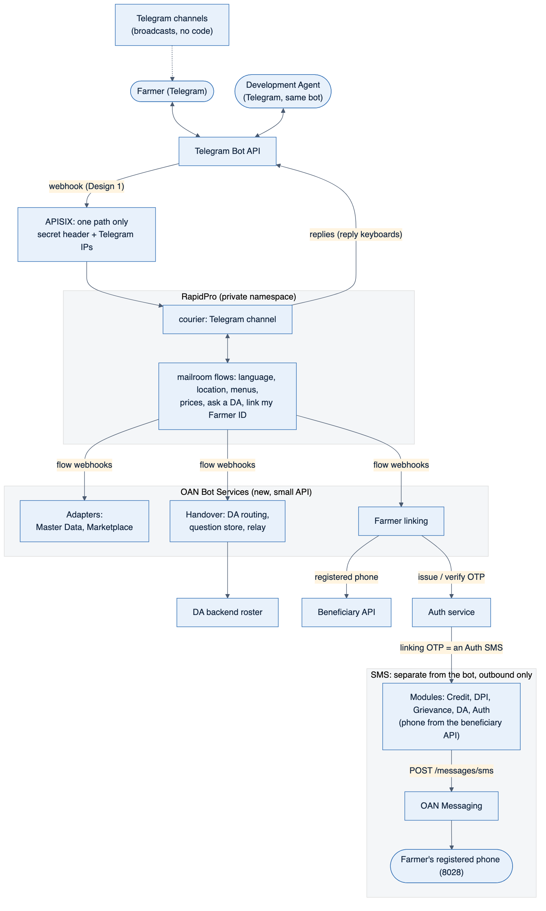
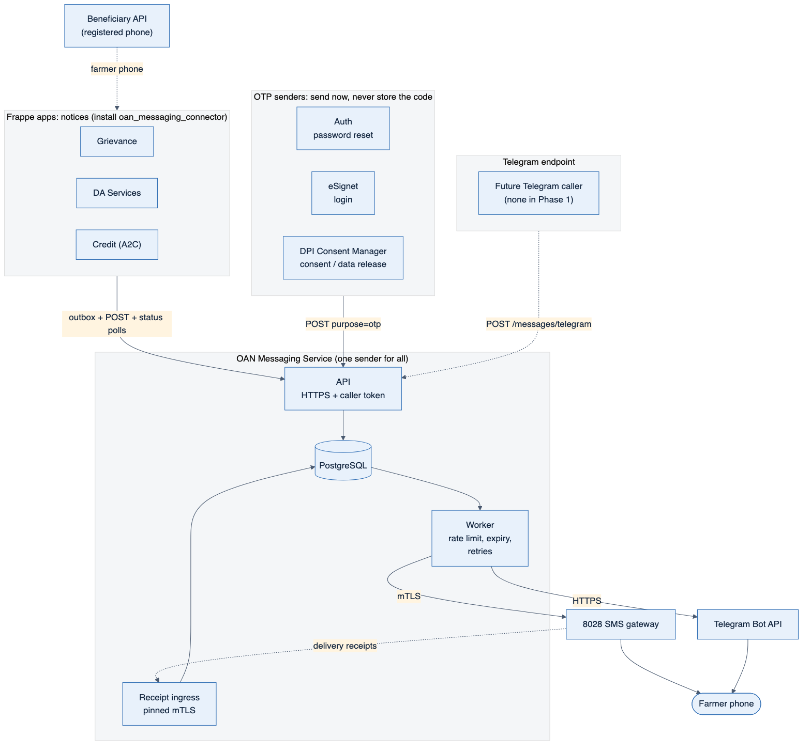

# 2 Architecture

## 2.1 The whole picture

| Component | Owns | Channel |
|---|---|---|
| **OAN Messaging Service** | The only SMS sender: API, PostgreSQL store, workers, 8028 adapter, delivery-receipt listener, cleanup. Also the only Telegram sender: every bot reply and every broadcast copy for OAN Bot Services, at one bot-wide pace, with the same rules as SMS (SMS-02 revised; TG-37). It alone holds the bot token. | SMS; Telegram |
| **Module services** (Credit, DPI Consent Manager, Grievance, DA Services, Auth, eSignet) | Deciding when to send, the text, the recipient's registered phone, and their own record of each message | SMS |
| **Frappe connector** (`oan_messaging_connector`) | A shared Frappe app that gives every Frappe module an outbox, safe retries and status polling | SMS |
| **Beneficiary API** (farmer registry) | The farmer's registered phone | Both |
| **OAN Bot Services** (small API and worker with its own PostgreSQL) | Receiving Telegram updates at its webhook (behind the gateway); the button conversation (language, notice, main menu, Updates on/off, Stop); farmer linking; staff linking; area broadcasts for the DA web app (choosing recipients, re-checking them, cancelling waiting copies; OAN Messaging sends) | Telegram |
| **Auth service** | Issues and verifies the farmer-linking OTP; sends it as an ordinary OTP SMS | SMS |
| **API gateway (APISIX)** | The single public Telegram webhook path and its controls (§5.3) | Telegram |
| **Telegram channels** | Broadcasts by DA Communications Officers (no code); targeted area broadcasts go through the bot (§6.8) | Telegram |

Not in this release (TG-36): RapidPro, Garage, DynamoDB, Elasticsearch and Valkey; and
the Reports Central weekly report of unanswered questions (§6.4.4, deferred).

## 2.2 SMS flow

1. A module decides to notify someone and takes the recipient's phone from its source
   of truth (for farmers, the beneficiary API).
2. It stores its own record of the intended message with a random UUID4 key, then calls
   `POST /api/v1/messages/sms` after its own transaction commits.
3. OAN validates, stores and answers `202`. A worker sends to 8028 later, within the
   rate limit and before the message's expiry.
4. 8028 reports delivery to OAN's receipt listener; the module polls
   `GET /api/v1/messages/{id}` for the outcome.

## 2.3 Telegram flow

1. Telegram calls the one public webhook path. APISIX checks the secret header and the
   source address, then passes the update to OAN Bot Services, which checks the header
   again and stores the update before answering (§5.3).
2. The Bot Services worker handles stored updates in order per chat: the button
   conversation, farmer linking (beneficiary API and Auth) and staff linking (DA backend).
3. Every reply is a text key, sent through OAN Messaging (`POST /api/v1/messages/telegram`,
   purpose `transactional`, with reply buttons).
4. Area broadcasts: the DA backend calls `POST /broadcasts`; OAN Bot Services chooses the
   recipients, re-checks each one, and submits each copy to OAN Messaging, which sends it
   with the same rules as an SMS (§6.8.4). The SMS copy is sent independently (§6.8.3).

## 2.4 Identities and phone numbers

| Identifier | What it is | Where it may appear |
|---|---|---|
| Registered phone | The farmer's phone in the farmer registry | Beneficiary API, the sending module, OAN Messaging (encrypted, purged after sending) |
| Alternate Telegram number | The number on the farmer's own Telegram account, approved by an OTP to the registered phone | OAN Bot Services link record only. Never in the registry, never used for SMS, never logged. |
| Farmer ID | The registry identifier | Beneficiary API, OAN Bot Services link record and subscription row |
| `chat_id` | Telegram chat identifier, needed to reply | The Bot Services subscription row (§6.8.1) and, sealed, a stored update until handled; OAN Messaging while a reply or broadcast copy is sent (encrypted, purged after sending, like a phone number). Never in logs. |
| `contact_ref` | HMAC-SHA256 of `chat_id` with a secret key | Logs, metrics, audit events and calls to OAN services |
| `da_ref` | Development Agent reference from the DA backend | Staff links and broadcast recipients |
| OAN message `id` | OAN's id for one accepted message | The sender's own record; used to poll |

## 2.5 Trust boundaries

* **Public:** the Telegram webhook path (§5.3); and, for 8028, the receipt listener behind
  pinned mutual TLS.
* **Internal, authenticated:** module services to OAN Messaging (bearer token per caller,
  HTTPS with strict certificate checks); OAN Bot Services to OAN Messaging (its own caller
  token) and to other OAN services (Keycloak service account); the DA backend to OAN Bot
  Services' `/broadcasts` (bearer token).
* **Staff only:** OAN Messaging operator commands (cluster access).
