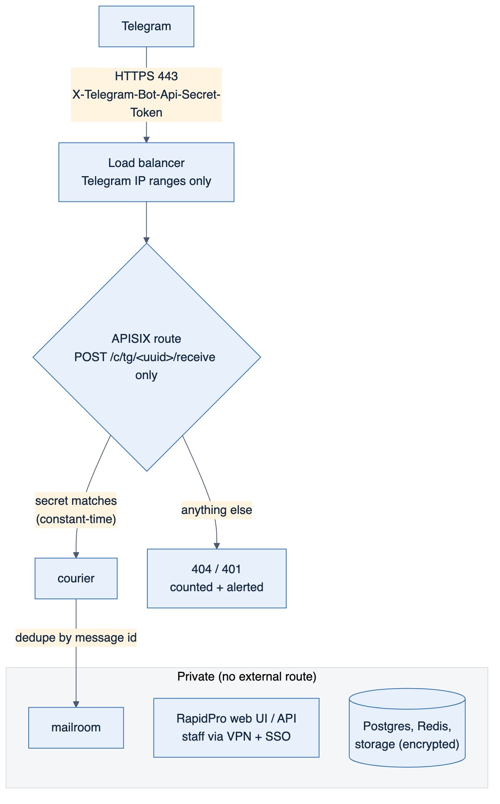

# 5 Telegram channel: platform, security and shared rules

## 5.1 Platform: OAN Bot Services plus OAN Messaging

Decided 24 November 2026 (TG-36): this release is **Telegram broadcasts plus
sign-up**, run by two OAN services. RapidPro is not used (§5.2).

* **Broadcasts:** area broadcasts from the DA web app reach linked farmers and staff (§6.8).
* **Sign-up:** the bot replies only to sign the farmer up and manage their updates: Start,
  language, privacy notice, Link my Farmer ID, I am OAN staff, Updates on/off and Stop.
  Linking is what gives the farmer's area, so a farmer who does not link gets no area
  broadcasts.
* **No questions:** the bot answers no questions and reads no free text.

| OAN Bot Services | OAN Messaging |
|---|---|
| Receives Telegram updates at `POST /telegram/webhook`, behind the gateway (§5.3) | Holds the bot token, the only place it is kept |
| Runs a short button conversation: language, privacy notice, main menu, farmer linking, staff linking, Updates on/off, Stop (§5.4) | Sends every Telegram message: the bot's replies and the broadcast copies, at one bot-wide pace (§5.8) |
| Chooses broadcast recipients for the DA web app and hands each copy to OAN Messaging (§6.8) | Claims bot replies before waiting broadcasts; honours Telegram's `retry_after` |
| Re-checks each recipient just before handing a copy over, and cancels copies still waiting in OAN Messaging when a farmer turns updates off or stops (§6.8.4) | Cancels a waiting Telegram message on request (`POST /api/v1/messages/{id}/cancel`) |
| Keeps links, subscriptions and broadcast records in its own PostgreSQL database | Keeps message records with the same rules as SMS (purge, statuses) |

Code: `oan_bot_services/` (README, `settings.py`, `telegram.py`, `conversation.py`,
`broadcasts.py`, `jobs.py`) and `oan_messaging/` contract 3.4.0 (`docs/openapi.yaml`).

What is **not** in this release (deferred, not supported): market prices, questions to
Development Agents and their routing, pest reports, media relay, agent assignment, officer
cover, escalation, longer conversation flows and the weekly report of unanswered
questions (§6.2-§6.4, §6.7). Anything a farmer types outside the buttons gets one fixed
reply: "Messages here are not read or answered. Please use the buttons below."

## 5.2 RapidPro: not used in this release

Decided 24 November 2026 (TG-36). RapidPro was the earlier choice for the bot (RP-D1 to
RP-D6, §8.2). It is dropped as a runtime because:

* the current line is licensed under BSL 1.1, which is not an open-source licence;
* it also needs DynamoDB or a compatible store, found while building the local stack;
* the open-source lines run on Django versions that no longer get security fixes.

So RapidPro, DynamoDB, Garage, Elasticsearch and Valkey are **not needed** for this
release. The RapidPro code in OAN Bot Services is kept but switched off
(`OAN_BOT_RAPIDPRO_ENABLED=false`, the default; TG-43): no RapidPro client is built, no
RapidPro job runs, its routes are not mounted, and its database columns are nullable.
The findings recorded earlier about RapidPro (webhook without secret, DynamoDB, private
addresses) are superseded for this release. Appendix A (the custom router) is also not
needed: OAN Bot Services now does that job.

## 5.3 Securing the webhook

The diagram shows the earlier design with RapidPro's courier; in this release the gateway
passes the update to OAN Bot Services instead (TG-38).

| Control | Setting |
|---|---|
| One route only | `POST /telegram/webhook` on a dedicated host; the gateway (APISIX) returns 404 for anything else |
| Secret header | DevOps registers the webhook with `setWebhook … secret_token=<random, 16-256 of A-Z a-z 0-9 _ ->` and `allowed_updates: [message]`. The **gateway and OAN Bot Services both** compare `X-Telegram-Bot-Api-Secret-Token` in constant time. A wrong or missing header: 401, nothing stored (`oan_bot_services/api/app.py`) |
| Source addresses | The gateway accepts only Telegram's webhook ranges (`149.154.160.0/20`, `91.108.4.0/22`); defence in depth, because the ranges can change |
| TLS | Public certificate, TLS 1.2 or later, port 443 |
| Limits | Body at most 64 KB (checked by OAN Bot Services); rate limit per source and a short timeout at the gateway; webhook `max_connections` about 20 |
| What is kept | Only `message` updates from **private** chats. The update's minimal fields are stored sealed **before** the 200 answer. A repeated `update_id` answers 200 and changes nothing; only the `update_id` is kept, for 30 days (privacy notice, 25 November 2026) (`oan_bot_services/telegram.py`) |
| Secrets | Bot token only in OAN Messaging's Kubernetes Secret. Webhook secret in a Kubernetes Secret, set on the gateway and in `OAN_BOT_TELEGRAM_WEBHOOK_SECRET`. One rotation runbook updates the gateway, OAN Bot Services and `setWebhook` together |
| Monitoring | Gateway counts of rejected calls (alert on spikes); scheduled `getWebhookInfo` (`last_error_message`, `pending_update_count`) |

## 5.4 Conversation rules

* **Buttons only.** Every reply has reply-keyboard buttons (sent through OAN Messaging as
  `reply_markup`, §5.8). An unexpected answer shows the same buttons again with "Please
  choose one of the options below." Free text outside a step gets the fixed "not read"
  reply (§5.1).
* **Steps:** `/start` → language (English, Amharic) → privacy notice → main menu with
  **Link my Farmer ID**, **I am OAN staff**, **Updates on/off** and **Stop updates**.
  `/menu` and the Main menu button work from every step; `/stop` is the same as Stop
  updates.
* **Order:** updates from one chat are handled in `update_id` order; if one fails, that
  chat's later updates wait.
* **Session:** a step expires after 30 minutes; the farmer returns to the main menu.
* **What the bot keeps** (stated in the privacy notice):

  | Data | Kept |
  |---|---|
  | `contact_ref`, language (no chat id in this table) | While the chat is linked or active; deleted 90 days after Stop with no link |
  | Farmer link: Farmer ID, registry area, fingerprint of the registered phone, alternate number sealed | Until a new link, or 90 days after Stop, a block or a deleted chat |
  | Subscription: chat id, state (active, stopped, unreachable), updates on or off | Same as the link |
  | A received update (sealed) | Until handled |
  | `update_id` | 30 days |
  | A broadcast's recipients and statuses; the chat id only until OAN Messaging has the copy; the text only until every copy is handed over | 30 days after the broadcast finishes |

  No chat history is kept. A code the farmer types lives only in that sealed update until
  it is handled, and is never logged.
* **Farmer Stop** (TG-40): turns updates off. Nothing more is sent, copies still waiting in
  OAN Messaging are cancelled, and the link and data are **deleted 90 days later** unless
  the farmer turns updates on again before then, which restores them without linking
  again. The bot says so ("If you do not turn updates on again, your link and data are
  deleted after 90 days").
* **No inactivity expiry** (TG-40): a subscription stays while the chat is reachable. A
  stopped, blocked or deleted chat is deleted 90 days after it stopped.
* **Staff Stop** (TG-44): work messages stay on; the bot replies that their supervisor or
  the DA app can unlink the account.
* **`contact_ref`** (HMAC-SHA256 of `chat_id` with a secret key) is the only chat
  identifier allowed in logs, metrics and calls to OAN services, except the Farmer ID and
  phone sent to the beneficiary API and Auth during linking.
* **Sending limits:** OAN Messaging sends every Telegram message at one bot-wide pace,
  `OAN_MSG_TELEGRAM_RATE_PER_SECOND` (20 by default, under Telegram's 30 a second),
  claims bot replies before waiting broadcasts, and waits for `retry_after` on HTTP 429.
  A blocked or deactivated user makes the subscription `unreachable`.

## 5.5 Texts and languages

* Every bot text is a key in `telegram/contracts/text-keys.yaml`, with English and
  Amharic values (TG-39). OAN Bot Services checks the file at start-up: every key, both
  languages, buttons at most 30 UTF-16 units. No sentences in code.
* **The Amharic translation is a release gate**: the file holds placeholders until the
  translator's texts are in, and they are reviewed by a native Amharic speaker.
* Broadcast text is sent **as written** by the sender in the DA web app, in one language;
  it is not translated (TG-46). The farmer's chosen language applies to the bot's own
  texts only.
* Languages are configuration: each chat's language is an ISO 639 code (`am`, `en`, later
  `om` for Afaan Oromoo).

## 5.6 Location and Master Data

* Region › zone › woreda › kebele, from Master Data (Development:
  `master-data.development.oanstaging.com`), cached 24 hours. In this release the bot has
  no location menus: a farmer's area comes from the registry when they link, and Master
  Data is used to list the kebeles under a broadcast's area (`oan_bot_services/areas.py`).
* Access through the bot's Keycloak service account with a read-only role on
  administrative areas.
* On failure, serve the last cached copy and log a warning.
* The **kebele code** from Master Data is the key used everywhere: QR codes, the DA
  backend roster and question records. Routing on it, and what the DA backend must hold,
  is in §6.4.

| Call | Request | Response fields (placeholders to confirm with the Master Data team) |
|---|---|---|
| List child areas | parent area code (none for regions), level | `area_code`, `name_am`, `name_en`, `level`, `parent_code` |
| Get area | area code | `area_code`, names, `level`, parent chain up to region |

## 5.7 Service adapters

* One adapter per service in OAN Bot Services, behind the egress allowlist, using the
  bot's own Keycloak service account (client-credentials, one client per environment,
  roles limited to the routes the bot calls). Never a person's or a farmer's
  credentials.
* Timeout 5 seconds; one retry on connection failure; circuit breaker after 5 failures
  in a minute.
* On failure the farmer sees "This information is not available right now. Please try
  again later." and Main menu.
* Agree each adapter's JSON contract with the owning team before coding against a stub,
  and keep the stub as a contract test.

## 5.8 OAN Bot Services and OAN Messaging

OAN Bot Services is an OAN Messaging **Telegram caller** (`bot-services`; TG-37), with purposes
`transactional` (replies), `alert` and `broadcast`. Contract 3.4.0 adds three things, all
optional and additive; SMS is unchanged (`docs/openapi.yaml`):

* **Reply buttons:** `reply_markup` on `POST /api/v1/messages/telegram`, either a keyboard
  (1-4 rows of 1-3 buttons, each 1-30 UTF-16 units, optional `request_contact`, `one_time`
  and `resize`) or `remove_keyboard`. Stored with the message, purged with the text, part
  of the idempotency fingerprint. Allowed with any purpose.
* **Cancel:** `POST /api/v1/messages/{id}/cancel` for the caller's own Telegram message
  that no worker has claimed yet: 200 with `status: failed`, `failure_code: cancelled`;
  repeat is harmless; claimed or finished gives 409 `not_cancellable`; someone else's or
  missing gives 404; an SMS gives 422. Cancel and claim cannot both win.
* **Telegram-only broadcast switch:** `OAN_MSG_TELEGRAM_BROADCAST_ENABLED` (default off)
  allows purpose `broadcast` on Telegram while SMS broadcasts stay closed. In Helm it is
  `workerTelegram.broadcastEnabled`, set only on the api and Telegram worker pods, so the
  SMS worker is never restarted by it.

Replies use source reference `bot:<contact_ref>:<n>` and a stored idempotency key; a reply
not handed over within 30 minutes is dropped. Broadcast copies keep the rules in §6.8.4.

## 5.9 Media storage

Not used in this release: the bot sends and receives no media, and Garage is not needed.
