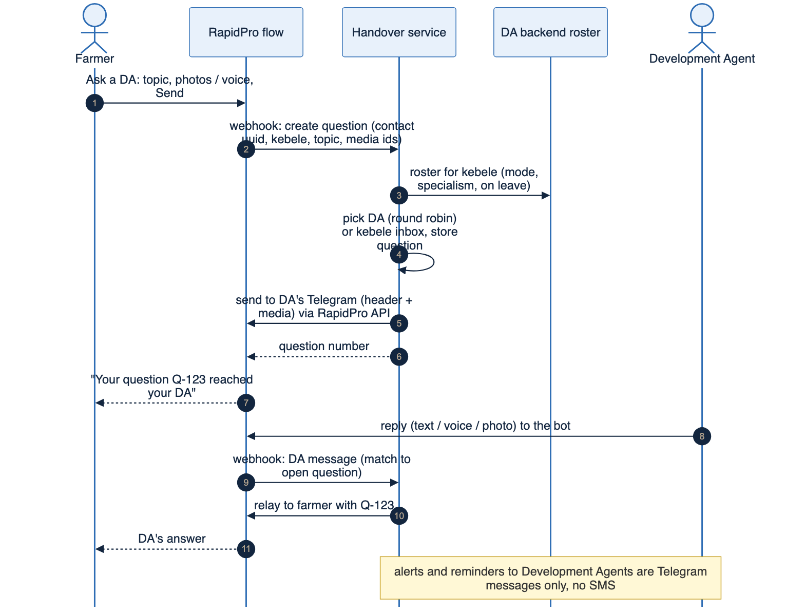
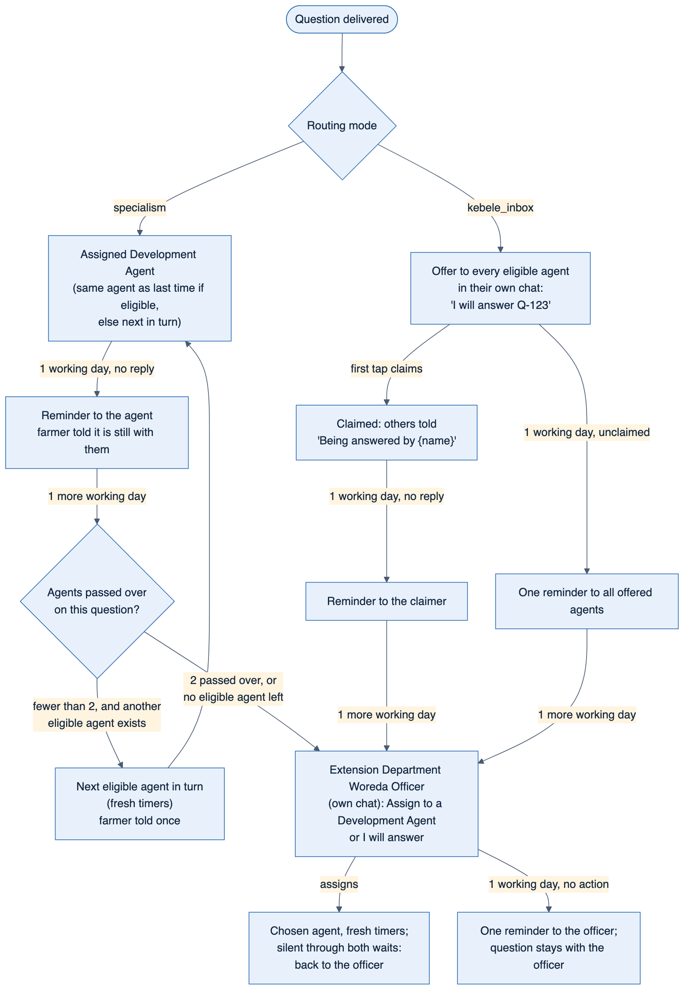
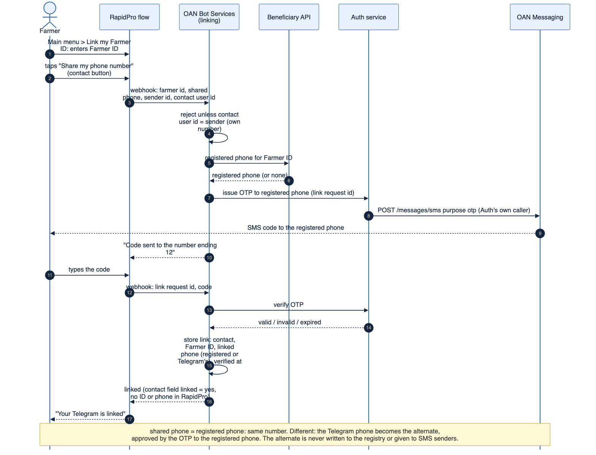

# 6 Telegram channel: modules

## 6.1 MOD-02: Broadcast channels and onboarding

Broadcasts need no bot code: DA Communications Officers post to official read-only
Telegram channels. The same printed materials bring farmers to the bot, because a bot
cannot send the first message.

**Steps**
1. ATI creates one official account that owns the bot and every channel, with two-step
   verification.
2. Create a read-only channel for each area that has a DA Communications Officer
   (region, zone or woreda), named consistently, for example "ATI Oromia Farmer
   Updates".
3. Posting rights go to the DA Communications Officer for each area; the list comes from
   the DA backend roster, and channel admins change when it changes.
4. Generate QR codes and short links for each channel and for the bot. Bot links carry a
   start code: `t.me/<bot>?start=k_<kebele code>` pre-selects the kebele;
   `?start=src_<code>` records where the farmer came from (counted by source only).
5. Development Agents share the links at Farmer Training Centres and kebele meetings.
6. Main menu has "Official updates", which opens the most local channel for the
   farmer's kebele: woreda, else zone, else region.

**On `/start`:** no code: language, privacy notice, location menus. `k_` code: language,
privacy notice, then "Is your kebele X?" with Yes / Choose another kebele.

**Acceptance:** a kebele QR code reaches Main menu with that kebele set, in two taps
after the notice; only the area's Communications Officer can post; Official updates
opens the most local existing channel.

## 6.2 MOD-01: Market prices

A farmer reaches today's price for one commodity at nearby markets in three taps, served
from the Marketplace backend (prices from NMIS).

**Steps**
1. The Marketplace team publishes the price API; the adapter follows it. Until then,
   build against a stub shaped like the table below.
2. Commodity menu: the 8 most-requested commodities first, then More (cached 24 hours).
3. Market menu: markets in the farmer's woreda first, then neighbouring woredas; or
   "Share my location" to sort by distance (used for the sort, not stored).
4. Price card with Another market, Another crop and Main menu. Compare: up to 5 markets
   for one commodity in one message.

| Call | Request | Response fields |
|---|---|---|
| List commodities | language | `commodity_id`, `name_am`, `name_en`, `unit` |
| List markets | woreda code, or latitude and longitude | `market_id`, `name_am`, `name_en`, `woreda_code` |
| Latest price | `commodity_id`, `market_id`(s) | `market_id`, `price_etb`, `unit`, `price_date`, `source` |

**Rules:** always show the price date; hide prices older than the age agreed with ATI
("There is no recent price for this market"); cache each price 15 minutes, never past its
source date; no personal data goes to the Marketplace backend.

**Acceptance:** three taps from Main menu; date on every card; Marketplace down gives the
fallback message within 6 seconds and Main menu still works.

## 6.3 MOD-03 and MOD-04: Development Agent handover and pest escalation

The farmer sends a question with photos or a voice note; OAN Bot Services passes it to a
Development Agent for the farmer's kebele and relays the reply. Pest and disease cases
go on from the Development Agent to the Crop Subject Matter Specialist, outside the
system.

**Steps**
0. Coverage check when the farmer opens "Ask a Development Agent" (§6.4.1). If the
   kebele is not covered, the farmer sees the "coming soon" message and no question is
   taken.
1. Topic menu: Crops, Livestock, Pests and diseases, Seed and fertilizer, Other.
2. Intake: "Send your question as a voice note, photos or text. Tap Done when finished."
   Up to 5 items within 10 minutes; other file types refused politely.
3. Confirm: show who receives it ("the Development Agent for Kebele X") with Send and
   Cancel; remind the farmer not to send ID numbers.
4. OAN Bot Services reads the roster again and chooses the receiver under the kebele's
   routing mode (§6.4). If no one is eligible, the farmer is told kindly and offered Main
   menu.
5. It creates the question record, delivers it to the Development Agent's chat with the
   bot (a header with the question number, kebele and topic; media as attachments), and
   acknowledges: "Your question has reached your Development Agent. Your question number
   is {handover_no}. You will get a reply here."
6. The Development Agent's reply (text, voice note or photo) is relayed to the farmer with
   the question number. Development Agents reply in the same bot. A reply goes to the
   agent's only open question; an agent with several open questions first picks the
   question number from a reply keyboard.
7. MOD-04: the Development Agent taps "Sent to Crop Specialist"; the farmer is told once:
   "Your Development Agent has asked a Crop Subject Matter Specialist to look at your
   photos." One reminder to the Development Agent if no reply by the region's reminder
   time.
8. Reminders, reassignment and the Woreda Officer follow the no-answer chain (§6.4.3).
   All alerts and reminders are Telegram messages; there is no SMS alert.

**Delivery port:** one interface, two implementations. Phase 1 builds Option A
(Development Agent's Telegram). Option B (DA app inbox, media in MinIO with short-lived
links) follows when the DA backend inbox is ready.

**Question lifecycle**

| Status | Set when | Next |
|---|---|---|
| `created` | Farmer taps Send | `delivered`, or `unavailable` |
| `delivered` | Sent to the assigned agent, or offered in kebele-inbox mode | `claimed` (inbox only), `replied`, `with_officer` |
| `claimed` | "I will answer" in kebele-inbox mode | `replied`, `with_officer` |
| `with_officer` | The no-answer chain reached the Woreda Officer (§6.4.3) | `delivered` (officer assigns an agent), `replied`, `closed` |
| `replied` | First reply relayed | stays `replied`; or `escalated`, `visit_planned`, `closed` |
| `escalated` | "Sent to Crop Specialist" | `replied`, `closed` |
| `visit_planned` | "Visit planned" | `replied`, `closed` |
| `closed` | "Mark as answered", or the farmer stops | none; a new message starts a new question |
| `unavailable` | No one could receive it | none (farmer told kindly) |

While a question is open, each reply carries "Ask a follow-up", which goes to the same
agent under the same number. When closed, the farmer is told "Your Development Agent has
marked question {handover_no} as answered."

**Question store** (OAN Bot Services PostgreSQL; message content and media are never
stored there; routing additions in §6.4.6)

| Table | Columns |
|---|---|
| `handovers` | `handover_id` (UUID), `handover_no`, `contact_ref`, `kebele_code`, `topic`, `language`, `routing_mode`, `assigned_da_ref`, `answered_da_ref`, `status`, `close_reason`, `created_at`, `delivered_at`, `claimed_at`, `first_reply_at`, `escalated_at`, `closed_at` |
| `handover_messages` | `id`, `handover_id`, `direction`, farmer and agent message references, `da_chat_ref`, `created_at` |
| `routing_state` | `kebele_code`, `specialism`, `last_da_ref`, `updated_at` |

A daily job deletes closed questions 90 days after closing (default). Migrations run as a
Helm pre-upgrade job.

## 6.4 Kebele routing

How a farmer's question reaches a Development Agent in the farmer's kebele, what happens
when nobody answers, and what the bot needs from the DA backend. Grievance routing is
out of scope (parked; the same roster and officer chain are candidates for it later).

### 6.4.1 Which kebele, and is it covered?

**Routing key.** Every question is routed on a Master Data **kebele code**, never a name.
The bot holds no list of farmers per Development Agent.

| Farmer | Kebele used |
|---|---|
| Not linked | The kebele chosen in the bot (location menus or a `k_` QR code) |
| Linked (§6.6), registry returns a kebele code equal to the chosen one | That kebele |
| Linked, registry kebele code differs from the chosen one | The bot asks once: "Your registration says Kebele X. Send your questions there, or to Kebele Y?" and routes on the answer, remembered until the farmer changes kebele |
| Linked, registry returns no kebele code | The chosen kebele (the gap is logged for the registry team) |

The beneficiary API must return the Master Data kebele code, not only a name: kebele
names are not unique (2,675 seeded kebeles share a name with another).

**Coverage check** when the farmer opens "Ask a Development Agent": read the kebele's
roster (R1, cached). The kebele is **covered** when at least one Development Agent is
eligible.

* **Eligible Development Agent:** listed for the kebele in R1, status `active`, Telegram
  linked, and not already passed over on this question.
* **Not covered:** the menu item still shows. Tapping it shows "The Development Agent
  service is coming soon to Kebele {kebele}. Meanwhile you can see market prices and
  official channels." with Market prices, Channels and Main menu. No question is taken.
* **Covered:** topic, intake and confirm as in §6.3. The roster is read again just
  before delivery, so leave and transfers since the menu opened are respected.

### 6.4.2 Routing modes

Set per kebele by an administrator in the DA backend (D5).

| Mode | How the receiver is chosen |
|---|---|
| `specialism` (default) | Map the topic to a specialism: Crops, Pests and diseases, Seed and fertilizer → `crops`; Livestock → `livestock`; Other → any. **(a) Same Development Agent first:** the agent who last *answered* this farmer (same `contact_ref`, kebele and specialism, within the retention period) gets it if eligible; the turn pointer does not move. **(b)** Otherwise the next eligible agent in turn for that specialism (pointer per kebele and specialism). **(c)** If none has the specialism, the next eligible agent in turn across the kebele. |
| `kebele_inbox` | **Private-chat inbox.** The question is offered to every eligible Development Agent of the kebele, each in their own chat with the bot, with a reply-keyboard button "I will answer Q-123". The first tap claims it; the others are sent "Q-123 is being answered by {name}." No Telegram groups are used. |

* Follow-ups to an open question go to the agent handling it.
* Only the agent who answered (or, in inbox mode, the claimer or the Woreda Officer) can
  close it.
* An agent who goes on leave, is transferred or unlinks while holding a question counts
  as passed over; their open questions move at once under the same rule.

### 6.4.3 When nobody answers

A question is never left with a silent Development Agent. The **Extension Department
Woreda Officer** is the end of the chain.

**Waits are counted in working time:** one wait is **one working day** (9 working hours),
working hours Monday to Friday 08:30–17:30 East Africa Time, excluding public holidays
from a configured calendar. Hours, days and calendars are configurable per region. A
question sent outside working hours starts its wait at the next working hour.

| Situation | After | The bot |
|---|---|---|
| Specialism mode: assigned agent has not replied | 1 working day | Reminds the agent once; tells the farmer the question is still with their Development Agent |
| Still no reply | 1 more working day | Marks the agent as passed over and tells them "Question {no} has been passed to a colleague."; assigns the next eligible agent in turn; tells the farmer once: "Your question {no} has been passed to another Development Agent, who will reply here." |
| **2 agents passed over**, or no eligible agent left | Immediately | Sends the question to the Woreda Officer's own chat with **Assign to a Development Agent** and **I will answer**; tells the farmer: "Your question {no} has been passed to the Extension Department Woreda Officer, who will make sure it is answered." |
| Inbox mode: nobody has tapped "I will answer" | 1 working day | One reminder to every offered agent |
| Still unclaimed | 1 more working day | To the Woreda Officer, as above |
| Inbox mode: claimed, but the claimer has not replied | 1 working day after the claim | Reminds the claimer once |
| Still no reply | 1 more working day | Releases the claim (the claimer counts as passed over) and sends the question to the Woreda Officer |
| Woreda Officer has not acted | 1 working day | Reminds the officer once; the question stays with the officer |

**Rules**
* A reply at any step ends the chain.
* **Assign to a Development Agent** shows the kebele's eligible agents by display name
  (from R1) on a reply keyboard. The chosen agent gets the question with fresh timers; if
  they stay silent through both waits, it returns to the officer.
* A reply from a passed-over agent is **not relayed**; they are told "This question has
  moved to a colleague." This prevents two answers.
* "Same Development Agent" (§6.4.2) means the one who answered, never one who was passed
  over.
* Every move is recorded (who held it, from when, why it moved) for the weekly summary
  and audit.

### 6.4.4 Weekly summary of unanswered questions

Every **Friday at 16:00 East Africa Time** (configurable), the bot sends each Woreda
Officer, zone extension head and regional extension head a summary for their area in
their own chat with the bot.

**Unanswered** = no reply from a Development Agent or officer one working day after the
question was sent. It includes questions now with the Woreda Officer and questions
closed as unavailable during the week.

| Recipient | Rows | Each row shows |
|---|---|---|
| Extension Department Woreda Officer | One per kebele in the woreda | Unanswered count, working days the oldest has waited, question numbers |
| Zone extension head | One per woreda in the zone | Unanswered count, working days the oldest has waited |
| Regional extension head | One per zone, then per woreda | Unanswered count, working days the oldest has waited |

* Never included: farmer names, chat ids, phone numbers or message content.
* A week with nothing unanswered sends one line: "No unanswered questions this week".
* A recipient who has not linked Telegram gets nothing; the miss is logged for the Admin
  team.
* Built from the question records and assignment history; the only extra DA backend call
  is R4 for recipients.

### 6.4.5 What the DA backend must provide

The DA backend owns every fact routing depends on; OAN Bot Services only reads it, caches
it and reports dead links. Until these exist, the bot is built and tested against a stub
with exactly these fields.

| # | Data | Requirement |
|---|---|---|
| D1 | Development Agent ↔ kebele assignment | Many-to-many, keyed by the Master Data kebele code (never the name), with start and end dates. One agent can cover several kebeles. |
| D2 | Specialism | One value per agent from a fixed shared list of codes: `crops`, `livestock` (extendable). Codes, not display labels. |
| D3 | Status | `active`, `on_leave` (optional return date) or `inactive` |
| D4 | Telegram link | The linked chat against the person's ref; one active link per person; a new link replaces the old one |
| D5 | Routing mode per kebele | `specialism` (default) or `kebele_inbox`, set by an administrator |
| D6 | Extension Department Woreda Officer | The officer for each woreda (woreda code), with their Telegram link |
| D7 | Zone and regional extension heads | The head for each zone and region (Master Data codes), with their Telegram link |

| # | Route (behind APISIX; bot service account scoped to these only) | In → out |
|---|---|---|
| R1 | Roster for kebele | kebele code → routing mode; for each person currently assigned: `da_ref`, display name, specialism, status, linked yes/no, delivery address. Unknown kebele → empty roster, not an error. |
| R2 | Link a person | one-time code + chat → ref, role (`development_agent`, `woreda_extension_officer`, `zone_extension_head`, `regional_extension_head`) and confirmed; or invalid / expired. Each code works once. |
| R3 | Report unreachable chat | ref + reason (blocked the bot, chat deleted) → link marked inactive until the person links again |
| R4 | Officers for area | woreda, zone or region code → the officer or head: ref, role, display name, linked yes/no, delivery address |

* **Freshness:** R1 and R4 are cached 5 minutes and R1 is read again before every
  delivery and every timer. Change events (the DA Registry's planned WebSub) may replace
  this later; not needed for Phase 1.
* **Outage:** if the DA backend is down, the last roster is used for up to 24 hours,
  then the kebele is treated as not covered.
* **Privacy:** the bot never sends the DA backend a farmer's chat id, phone number or
  name.

### 6.4.6 Inside OAN Bot Services

Timers and assignment history live in PostgreSQL, so a restart loses no deadline; caches
are only caches.

| Store | Addition |
|---|---|
| Cache | Roster per kebele (R1) and officer per area (R4): 5 minutes fresh; last copy kept 24 hours for outages |
| `handovers` (new columns) | `holder_ref`, `holder_role`, `next_timer_at`, `timer_kind` (`reminder`, `reassign`, `claim_reminder`, `officer_reminder`), `pass_count`, `routing_kebele_code` |
| `handover_assignments` (new) | `handover_id`, `ref`, `role`, `assigned_at`, `reminded_at`, `ended_at`, `end_reason` (`answered`, `passed_over`, `claim_released`, `on_leave`, `transferred`, `unlinked`, `claimed_by_colleague`, `assigned_by_officer`) |
| `handover_offers` (new, inbox mode) | `handover_id`, `ref`, `offered_at`, `outcome` (`claimed`, `claimed_by_colleague`, `expired`) |
| `weekly_summaries` (new) | `recipient_ref`, `week_start`, `sent_at`, `status` |
| `working_calendar` (new) | region code, working hours, public holidays |

* **Timer job:** once a minute, a single worker picks questions whose `next_timer_at`
  has passed and applies §6.4.3. Each step is idempotent, so a crash or a second run does
  no harm. `next_timer_at` is computed from the working calendar.
* **Summary job:** weekly, from `handover_assignments`; once per recipient per week.
* **Lifecycle:** one new status, `with_officer` (next: `delivered` when the officer
  assigns an agent, `replied`, or `closed`). Passing a question between agents is an
  assignment change, not a status change.
* Logs, metrics and audit events use `contact_ref` only; officer and agent refs may
  appear, chat ids never.

### 6.4.7 Acceptance criteria

Tested against the DA backend stub, with a fake clock and a test working calendar.

* A kebele with no eligible agent shows "coming soon" and takes no question; it becomes
  covered within 5 minutes of an agent linking.
* A linked farmer whose registry kebele differs from the chosen one is asked once, and
  the answer is used for routing.
* Specialism mode: a Livestock question goes to a livestock agent; successive questions
  from different farmers take turns; a kebele with no agent of that specialism takes
  turns across all.
* A farmer's new question goes to the agent who last answered them when eligible, and to
  the next in turn when that agent is on leave, unlinked or transferred.
* No reply: reminder after 1 working day; reassignment after 2 with the farmer told once;
  after 2 agents are passed over the question reaches the Woreda Officer; a passed-over
  agent's late reply is not relayed.
* A question sent on Friday at 17:00 is reminded on Monday at 17:00 (a working day later),
  not on Saturday; public holidays are skipped.
* Inbox mode: the first "I will answer" claims it and the others are told; unclaimed after
  1 working day gets one reminder; after 2 it goes to the Woreda Officer. A silent
  claimer is reminded after 1 working day and released to the officer after 2.
* The officer can assign or answer; the officer is reminded once after 1 working day.
* DA backend unavailable: routing continues on the cached roster for 24 hours, then the
  kebele shows "coming soon".
* Weekly summary on Friday 16:00: correct counts per kebele, woreda and zone for a seeded
  week; no farmer name, chat id or message text in any summary or log line.
* Restart during a wait: the timer still fires once, at the right time.

## 6.5 Linking Development Agents and officers

1. In the DA app the person opens "Link Telegram"; the DA backend issues a one-time code
   (8 characters, valid 15 minutes, tied to their ref). This covers Development Agents,
   Extension Department Woreda Officers and zone and regional extension heads.
2. The person opens the bot and sends the code; OAN Bot Services calls R2, and the DA
   backend stores the chat as their delivery address.
3. A new phone or account repeats this; the new chat replaces the old. Someone who leaves
   or moves drops out of the roster and their open questions move (§6.4.2).
4. A wrong or expired code is refused kindly; 5 failures in an hour lock linking for that
   chat for an hour (the lockout stays in the bot).
5. A person who blocks the bot or deletes the chat is reported through R3.

**Option B** (later): the DA app inbox, with "Post question" (`handover_id`,
`contact_ref`, kebele, topic, text, media links, language → message id) behind the same
delivery port.

**Acceptance:** a question with 2 photos and a voice note reaches the right agent and the
farmer is acknowledged within 5 seconds; the reply reaches the farmer with the question
number; no phone number or chat id is sent to either side; "Sent to Crop Specialist"
tells the farmer once.

## 6.6 MOD-08: Farmer linking (OTP to the registered phone)

Linking tells the bot which registered farmer it is talking to. It is optional: menus
and prices work without it; MOD-06 and MOD-07 need it.

**Steps**
1. The farmer chooses Main menu › Link my Farmer ID and types their Farmer ID.
2. The farmer taps Share my phone number (Telegram's contact button). OAN Bot Services
   accepts it only if the shared contact's user id equals the sender's.
3. OAN Bot Services gets the registered phone and the registered **kebele code** for the
   Farmer ID from the beneficiary API. An unknown ID and a missing phone give the same
   kind message (visit the kebele office).
4. OAN Bot Services asks the Auth service to send an OTP to the **registered** phone.
   Auth sends it through OAN Messaging as its own OTP caller. The bot shows only the last
   two digits of the number.
5. The farmer types the code; OAN Bot Services asks Auth to verify it.
6. On success OAN Bot Services stores the link (contact, Farmer ID, linked phone, a
   fingerprint of the registered phone, registered kebele code, time) and sets only
   `linked = yes` on the RapidPro contact. If the registered kebele differs from the one
   the farmer chose, the bot asks which one to send questions to (§6.4.1).
   * **Same number:** the Telegram number equals the registered phone.
   * **Alternate number:** the Telegram number differs; the OTP to the registered phone
     approves it. It is used only for Telegram-specific updates, never written to the
     registry, never given to SMS senders and never logged.
7. **Unlink:** Stop, Main menu › Unlink, or a new link from another Telegram account
   removes the old link. If the registered phone changes, the link must be approved
   again.

| Call | Inputs and outputs |
|---|---|
| Beneficiary API: registered phone and kebele | Farmer ID → phone and Master Data kebele code, or not found (new lookup) |
| Auth: issue linking OTP | Farmer ID, registered phone, link request id → sent, or rate-limited (new service-client route) |
| Auth: verify linking OTP | link request id, code → valid, invalid or expired |

**Acceptance:** the OTP always goes to the registered phone; someone else's contact is
refused; 5 wrong codes in an hour lock linking for an hour; OTP expiry is set by Auth
(at most 30 minutes); the alternate number never reaches the registry, SMS senders or
logs; the bot makes no call to OAN Messaging. The code the farmer types is a message, so
it sits in RapidPro's history under RP-D1 retention; it is single-use and short-lived.

## 6.7 MOD-06 and MOD-07: Verified status checks (deferred)

Do not build in Phase 1; reserve the menu slot and the adapter interface.

* Interface: `check_status(reference, farmer_id) -> {status_label, updated_date} | not_verified`.
* The farmer must be linked (§6.6); the check uses the Farmer ID from the link.
* The comparison happens in the Grievance service or A2C backend, never in the bot. A
  failed check returns the same message as an unknown reference; lock out after 3
  failures in an hour.
* Needs new bot-only routes in both backends, behind the APISIX gateway.
