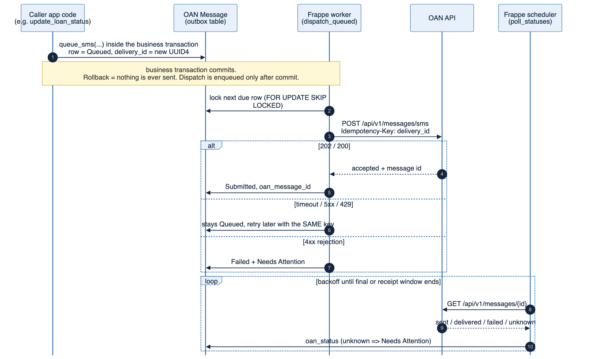
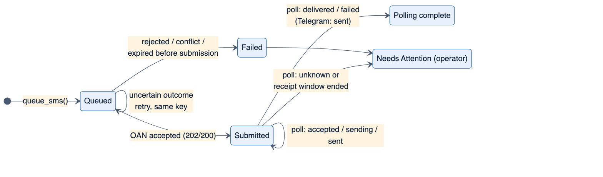

# 03 The Frappe connector (`oan_messaging_connector`)

A reusable Frappe app that every Frappe module installs to send notices through OAN. It
owns everything that is the same for all callers, so each module only adds its texts and
its call sites.

* **Status:** trial build, 11 tests passing; trial-tested end to end with Credit on
  Frappe 16.56.0 and Python 3.14. Not released. MIT licence, as for other OAN services.
* **Where:** in the developer package, `code/oan_messaging_connector.tar.gz` (source) and
  `code/oan_messaging_connector.bundle` (git history, branch `develop`). Unpack the
  tarball, or `git clone oan_messaging_connector.bundle`, then `bench get-app` the folder.



## 1. What it gives you

| Part | Purpose |
|---|---|
| **OAN Message** doctype | The outbox: one row per intended message. `delivery_id` (UUID4, set at insert) is the Idempotency-Key and never changes. Rows cannot be deleted. |
| **OAN Messaging Settings** (single doctype) | Enabled, base URL, caller token (Password field), CA bundle, HTTP attempts, receipt window |
| `queue_sms(...)` | The only call your module makes |
| `dispatch_queued` | Runs right after your transaction commits, plus every minute as a safety net. `FOR UPDATE SKIP LOCKED` and one commit per row, so it is safe with several workers. |
| `poll_statuses` | Every minute: GET on rows whose poll is due (backoff 1 min, capped at 6 h). Never resends. |
| One-SMS check | Refuses text that does not fit one part, before calling OAN |

## 2. Outbox row lifecycle (what you see in the Desk)



| Desk status | Meaning |
|---|---|
| **Queued** | Waiting to be handed to OAN, or retrying after an uncertain outcome (same key) |
| **Submitted** | OAN accepted it. **OAN Status** shows progress: `sent`, then `delivered` |
| **Failed** | OAN refused it (validation, conflict, expired before submission). **Needs Attention** is set. |
| **Needs Attention** (flag) | Failed rows, `unknown` outcomes, or polling ended without a final status. A person checks. |

## 3. Install

1. Add the app to the bench and install it on the site:

   ```
   bench get-app <path or repo>/oan_messaging_connector
   bench --site <site> install-app oan_messaging_connector
   ```

2. In your app's `hooks.py`:

   ```python
   required_apps = ["oan_messaging_connector"]   # A2C also lists its own "oan_auth_service"
   ```

3. Make sure the scheduler **and workers** run on the site. Dispatch runs as a
   background job on the **`short`** queue, so a `short` worker is required:
   `bench --site <site> enable-scheduler`, and `bench worker --queue short,default,long`
   (or your supervisor's equivalent).

## 4. Configure (per site)

Either set **OAN Messaging Settings** in the Desk, or use `site_config.json`. Site config
wins, which suits secrets injected by Kubernetes.

```
bench --site <site> set-config oan_messaging_enabled 1
bench --site <site> set-config oan_messaging_base_url https://oan-messaging.<env>.example.invalid
bench --site <site> set-config oan_messaging_token <token from the OAN operator>
bench --site <site> set-config oan_messaging_ca_bundle /path/to/ca.pem   # only for a private CA
```

* The base URL **must be HTTPS**; the client refuses anything else.
* Frappe v16 runs Python 3.14, which **verifies certificates strictly**. A private CA's
  certificates must carry Subject and Authority Key Identifiers (see
  [21](21-environments-and-onboarding.md)).
* While the connector is disabled, `queue_sms` does nothing and returns `None`, and your
  app behaves exactly as before. This is your per-site switch for cut-over and rollback.

## 5. Call it

```python
from oan_messaging_connector.api import queue_sms

name = queue_sms(
    recipient=doc.phone_number,             # 09/07/+251 Ethiopian mobile
    text=rendered_text,                     # already in the recipient's language; one SMS part
    purpose="transactional",                # otp | transactional | alert
    source_reference=f"a2c:{doc.name}:loan_disbursed",
    reference_doctype=doc.doctype,
    reference_name=doc.name,
    event="loan_disbursed",
    language="en",
    expires_at=None,                        # timezone-aware datetime when the message has a deadline
)
```

Rules:
* **Call it inside the business transaction**, at the line of code where the change
  happens: the API function or service method, not a generic `on_update` hook. It only
  inserts a row; sending starts after commit, so a rollback sends nothing.
* **It never raises because of messaging.** When disabled, or when the message is invalid
  (too long, bad purpose, OTP without expiry, already expired), it returns `None` and
  writes an **Error Log** entry. Your business action is never blocked by an SMS.
* **One call per recipient.** Two people means two calls with the same
  `source_reference`.
* Keep your **texts and event mapping in your own app**. The Credit pattern is a good
  template: `oan_a2c/oan_messaging/events.py` holds the templates, `render()` and the
  event mapping; `notify.py` holds the call sites.

### Things to get right in the call

* **`expires_at` must be timezone-aware.** Frappe datetimes are naive (system time zone).
  Convert first:

  ```python
  from zoneinfo import ZoneInfo
  from frappe.utils import get_datetime, get_system_timezone

  expires_at = get_datetime(visit.visit_at).replace(tzinfo=ZoneInfo(get_system_timezone()))
  ```

* **`language`** is informational (`en`, `am`, later `om`). Render the text in the
  recipient's language yourself; the connector does not translate.
* **Phone format:** the connector checks the format (09…, 07…, 2519…, +2519…, +2517…)
  and returns `None` with an Error Log for anything else. It does not normalise; strip
  spaces and dashes before calling.
* **Retries:** OAN Messaging Settings › HTTP attempts (default 3) applies per dispatch
  run; the sweep keeps retrying an uncertain row with the same key until it is
  accepted or expires.

### Did it work? (fresh site)

1. Call your code path once with a `0900000xxx` number.
2. An **OAN Message** row appears with status **Queued**, and Error Log has no new entry.
3. Within a minute it becomes **Submitted** with an OAN id.
4. In the local trial stack, the fake gateway inbox (`http://127.0.0.1:18028/inbox`)
   shows the text, and **OAN Status** becomes `delivered`.
5. Disable the connector (`oan_messaging_enabled 0`): your code path still works and no
   row is created.

To show delivery state on your own records, call `messages_for(doctype, name)`; there is
no status-change signal, so read it when the record is displayed.

## 6. Operate

* Desk, **OAN Message** list: filter **Needs Attention**.
* `oan_messaging_connector.api.messages_for(doctype, name)` returns the delivery state of
  one business record, for support screens.
* **Do not** put OTP codes through the connector: its outbox stores the text. Use the OTP
  pattern ([04](04-otp-senders.md)).

## 7. Known limits (follow-ups)

| Limit | Plan |
|---|---|
| SMS only | Telegram support can be added the same way when a Frappe module needs it |
| Text stays on the row after the final status | Add a purge of `text` after the final status, plus a retention period (privacy) |
| No send-now helper for OTPs | Add `send_otp_now()`, which keeps the text only in job arguments, for Auth |
| Polling stops at 7 days for SMS (configurable) | Matches the receipt window |
