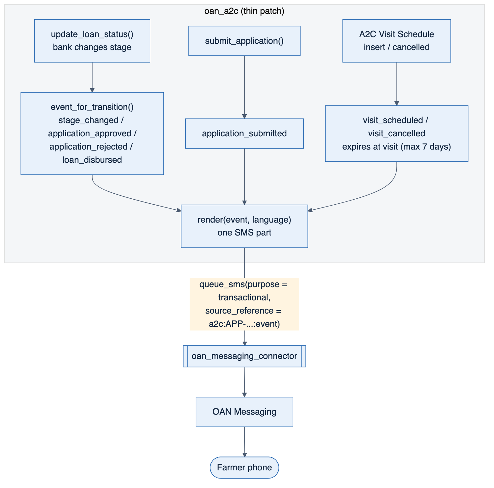

# 10 Credit (A2C): farmer SMS for the loan lifecycle

| | |
|---|---|
| **Pattern** | Frappe connector ([03](03-frappe-connector.md)) |
| **Status** | **Patch built and trial-tested end to end** (Frappe 16.56.0, Python 3.14, real OAN over HTTPS, fake 8028) |
| **Code** | `code/patches/oan_a2c_service/0001-*.patch` (branch `oan-messaging-sms` on base `3887b8b`), plus the connector app |
| **Today** | A2C sends the farmer **no SMS at all**; its only notifications are in-app messages for bank staff and agents |



## 1. What the farmer receives

| Event | Raised in A2C code | Message (English source) | Expires |
|---|---|---|---|
| `application_submitted` | `api/v1/farmer/applications.py` `submit_application` | Your loan application {app} was sent to {bank}. We will tell you when it moves forward. | no |
| `stage_changed` | `api/v1/loan_applications.py` `update_loan_status` (In Transition) | Your loan application {app} with {bank} is now at stage: {stage}. | no |
| `application_approved` | same, when the bank's stage label is "Approved" | {bank} approved your loan application {app}. The bank will contact you about next steps. | no |
| `application_rejected` | same, Reject transition | {bank} did not approve loan application {app}. Ask your agent or the bank for the reason. | no |
| `loan_disbursed` | same, Complete transition | {bank} has paid out the loan for application {app}. Contact the bank if you have not received it. | no |
| `visit_scheduled` | A2C Visit Schedule inserted (status Scheduled) | An agent will visit you on {date} at {time}, at {place}. Visit ref {visit}. | at the visit (max 7 days) |
| `visit_cancelled` | A2C Visit Schedule status → Cancelled | Agent visit {visit} on {date} is cancelled. Your agent will contact you to book a new time. | at the visit |

Every text is sent with the prefix "OAN Credit: " (12 characters, added by `render()`),
and the prefixed text fits one SMS at the maximum field lengths (bank 30, stage 30, place
40 characters). The table shows the text without the prefix.

**Phone number:** the patch reads the phone from A2C's own records (`phone_number` on the
application or lead). The agreed source is the registered phone from the beneficiary
API; switch when that route exists (guide 22). **Visit messages** are English only in the
patch; add Amharic before go-live.

(*) Visit SMS use `doc_events` on **A2C Visit Schedule** because inserting a schedule,
or changing its status to Cancelled, *is* the business event and each happens once per
visit. For records that are saved many times (applications, grievances, DA plans), raise
events at the call site instead (guides 03 and 13).

**By design, messages carry no amounts, rejection reasons or free text typed by bank
staff.**

**Not possible yet** (A2C has no data for them): documents requested, repayment due or
overdue, disbursal confirmed by a bank integration. The consent OTP is sent by the
Consent Manager ([11](11-dpi-consent.md)), never by A2C.

## 2. Integration steps

| # | Step | Owner | Done when |
|---|---|---|---|
| 1 | Install `oan_messaging_connector` on each A2C site | A2C dev | `bench --site <site> list-apps` shows it |
| 2 | Apply the patch: `required_apps`, `oan_a2c/oan_messaging/{events,notify}.py`, 2 call sites, 2 visit hooks, tests | A2C dev | `run-tests --app oan_a2c`: 6 new tests pass, and nothing that passed before fails |
| 3 | Confirm, per bank, which stage label means "approved" (`event_for_transition`) | A2C product + banks | Labels recorded; the mapping adjusted if a bank uses another word |
| 4 | Agree bank short names (at most 30 characters) and the display language source | A2C product | `bank_name` values checked |
| 5 | Add Amharic, Afaan Oromo and other translations to `TEMPLATES` | A2C content | Each template, at maximum field lengths, fits one SMS (70 characters if Amharic): the test passes |
| 6 | OAN operator registers caller `a2c` (sms, transactional) and issues a token | OAN ops | Token stored in the site's secret |
| 7 | Set `oan_messaging_*` site config (HTTPS URL, token, CA if private); scheduler and workers running | DevOps | `queue_sms` creates rows and they reach **Submitted** |
| 8 | Dev-environment acceptance ([20](20-testing-and-acceptance.md), CR-01 to CR-08) | QA | Evidence recorded |

## 3. How the code is laid out (after the patch)

```
oan_a2c/oan_messaging/events.py   # TEMPLATES, render(), event_for_transition(), visit_deadline()
oan_a2c/oan_messaging/notify.py   # notify_application(), notify_status_change(), visit hooks -> queue_sms()
oan_a2c/api/v1/farmer/applications.py   # submit_application -> notify_application(doc, "application_submitted")
oan_a2c/api/v1/loan_applications.py     # update_loan_status -> notify_status_change(doc, archetype, stage_label)
oan_a2c/hooks.py                        # required_apps + A2C Visit Schedule doc_events (*)
```

* Application events are raised from the API functions, **not** `on_update`, because A2C
  sets `status` with `db_set`, which skips `on_update`.
* A status or stage that did not change sends nothing.

## 4. Trial evidence (15 November 2026)

* A2C suite: 299 tests. The 6 new tests pass. The failure set is identical to the
  unpatched baseline: 6 pre-existing failures in `test_farmer_b2c`, unrelated to this
  work.
* End to end: three real `update_loan_status` calls (Verified, Approved, Disbursed) plus
  a visit scheduled and then cancelled. Each message reached the gateway once and showed
  **Submitted → delivered** in the Desk.
* Not run end to end: `submit_application`, because A2C rightly requires an approved
  consent first. It is covered by a unit test.

## 5. Decisions A2C owns

* Approved-stage label per bank.
* Whether the assigned agent also gets a copy.
* Translations.
* Whether `visit_scheduled` should also fire for reschedules (today: insert only).
