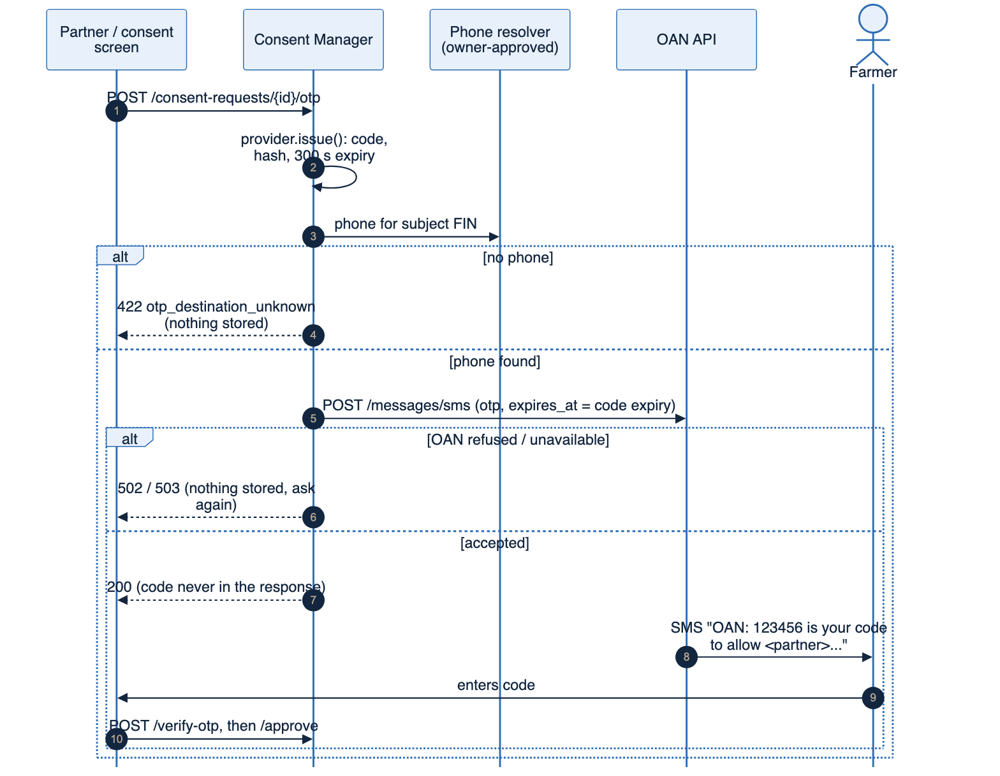

# 11 DPI Consent Manager: consent OTPs by SMS

| | |
|---|---|
| **Pattern** | OTP sender ([04](04-otp-senders.md)); FastAPI service, calls OAN directly |
| **Status** | **Patch built and trial-tested end to end** (real Consent Manager HTTP API, real OAN over HTTPS, fake 8028) |
| **Code** | `code/patches/consent-management/0001-*.patch` to `0003-*.patch` (branch `oan-messaging-otp` on base `b6d5e45`) |
| **Today** | **The OTP is generated but never delivered**: the provider only logs it, in plain text. Every consent-gated data release (A2C applications, bank partners) needs manual help. **This is the most urgent gap.** |



## 1. What the farmer receives

| Message | Raised in | Purpose | Text |
|---|---|---|---|
| Consent OTP | `lifecycle_service.issue_otp` → `otp_provider.issue` | `otp`, expires with the code (300 s) | OAN: {code} is your code to allow {partner} to use your registry data. It expires in 5 minutes. Never share this code. |
| Data-release OTP | `aggregator_service` (status `pending_otp`) | `otp` | OAN: {code} is your code to release your registry data to {partner}. It expires in 5 minutes. Never share this code. |
| Consent granted, denied, revoked, expired; data shared (**phase 2**) | `lifecycle_service`, `consent_service`, `aggregator_service` | `transactional` | Templates ready in `examples/dpi_consent_notifications.py`; not wired yet |

## 2. What the patch changes

| File | Change |
|---|---|
| `services/otp_delivery.py` (new) | Builds the SMS: purpose `otp`, `expires_at` = the code's expiry, key per issue, partner display name, phone from the resolver. Calls OAN, and on failure raises `OtpError` 422, 502 or 503. |
| `services/otp_provider.py` | Both providers call delivery after issuing. **The code is masked in logs** unless `otp_debug_enabled`. |
| `services/lifecycle_service.py`, `services/aggregator_service.py` | A delivery failure on **issue** becomes a visible error (it was a bare 500); nothing is stored |
| `config.py` | `oan_delivery_enabled` (default **off**), `oan_base_url`, `oan_token`, `oan_ca_bundle`, `oan_timeout_seconds`, `oan_max_attempts`, `oan_phone_resolver`, `oan_otp_phone_map` |
| `oan_client/` (vendored) | The OAN client, unchanged apart from relative imports |
| `backend/tests/test_oan_otp_delivery.py` | 5 tests |

## 3. Integration steps

| # | Step | Owner | Done when |
|---|---|---|---|
| 1 | **Fix the build first.** At `b6d5e45` the service does not build or run: the `openg2p-fastapi-common` pin is broken (it needs commit `9ddccc00f5`, or the code updated to the new `crypto` package), and `greenlet` is missing | DPI dev | Image builds and starts from a clean checkout |
| 2 | Apply the three patch commits | DPI dev | `pytest backend/tests`: 17 pass; sanity suite as before |
| 3 | **Phone for OTPs.** The Consent Manager stores no phone, only the Fayda FIN. The agreed direction is the farmer's **registered phone from the beneficiary API**. Implement `resolve_phone()` against that route once the identity owner publishes it (the route, its access, and what to do when there is no phone), and remove the dev phone map. | **Identity owner** and DPI | Route published; resolver implemented and tested |
| 4 | Partner display names (at most 30 characters; longer ones are shortened) | DPI | Names checked |
| 5 | Amharic OTP text, which must fit 70 characters with the code and partner name. The patch measures every OTP text against one SMS part and, when the full text does not fit (for example an Amharic partner name), sends a short text without the partner name. | DPI content | Measured |
| 6 | OAN operator registers caller `dpi-consent` (sms; otp, transactional) and issues a token | OAN ops | Token in the secret store |
| 7 | Set `CONSENT_MANAGER_OAN_*` (HTTPS URL, token, CA if private), `..._OAN_DELIVERY_ENABLED=true` | DevOps | An OTP request produces an SMS |
| 8 | Dev acceptance ([20](20-testing-and-acceptance.md), CM-01 to CM-08) | QA | Evidence recorded |
| 9 | Phase 2: wire the consent notices (granted, denied, revoked, expired, data shared) | DPI | Optional for the pilot |

## 4. Responses the consent screen must handle

| API answer on `POST /consent-requests/{id}/otp` | Meaning | Screen |
|---|---|---|
| `200` | Code handed to OAN (the code is never in the response) | "We sent a code to your phone" |
| `422 otp_destination_unknown` | No phone for this farmer | "No phone number on record": route to support |
| `502 otp_delivery_rejected` | OAN refused the message | "Could not send the code": alert ops |
| `503 otp_delivery_unavailable` | OAN unreachable after retries | "Try again in a moment" |

## 5. Trial evidence (15 November 2026)

* The OTP SMS reached the gateway through OAN. A wrong code was rejected (401); the right
  code verified, then approval succeeded.
* A re-issue sent a new SMS with a new key, and the stale code was rejected.
* Unknown phone: 422, and no SMS.
* No OTP code anywhere in the Consent Manager log.
* Unit tests 5/5. Not run over HTTP: the data-release OTP (it needs registries; it uses
  the same delivery module) and the service with auth on.

## 6. Configuration example (dev)

```
CONSENT_MANAGER_OAN_DELIVERY_ENABLED=true
CONSENT_MANAGER_OAN_BASE_URL=https://oan-messaging.dev.example.invalid
CONSENT_MANAGER_OAN_TOKEN=<from the OAN operator; secret>
CONSENT_MANAGER_OAN_CA_BUNDLE=/etc/oan/ca.pem          # only for a private CA
CONSENT_MANAGER_OAN_PHONE_RESOLVER=map                 # dev only, until step 3 is done
CONSENT_MANAGER_OAN_OTP_PHONE_MAP={"<test FIN>": "0900000601"}
```

## 7. Farmer registry API and VeriFayda

Both repositories contain no code yet. When they are built:
* **verification codes** (FaydaPass, VeriFayda): reuse this OTP pattern and the same
  delivery module;
* **e-voucher issued, redeemed or expiring:** use transactional notices with the
  voucher's deadline as `expires_at`.

Each needs its own OAN caller.
