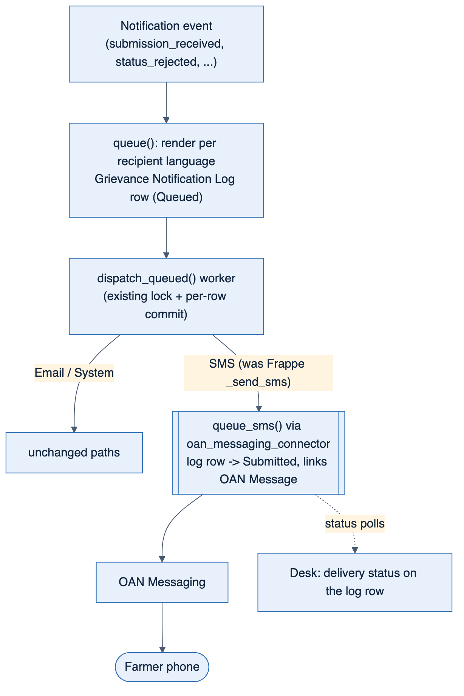

# 12 Grievance: farmer notices

| | |
|---|---|
| **Pattern** | Frappe connector ([03](03-frappe-connector.md)) |
| **Status** | Designed; **not built**. The connector and the Credit patch are the reference implementation. |
| **Today** | SMS goes through Frappe core `_send_sms` from `services/notifications.py` (`_send_sms_row`), with no idempotency key, no expiry and no delivery status. Reviewed at `7118e82` and `4d03412`. |



## 1. What stays the same

Grievance keeps all of its own logic: Notification records per (event, channel),
eligibility, recipients, language choice, rendering, the dedup rule and the **Grievance
Notification Log**. Email and System Notification are unchanged. **Only the SMS send
step changes.**

## 2. SMS events (12)

`submission_received`, `duplicate_detected`, `status_in_progress`, `grievance_confirmed`,
`auto_closed_no_response`, `grievance_closed`, `status_rejected`, `more_info_requested`,
`anonymity_disclosure_requested`, `deadline_extended`, `structured_response_sent`,
`confirmation_window_open`.

* Purpose `transactional`; no expiry.
* `source_reference = grievance:<grievance_id>:<event>`. Keep the event names exactly,
  including underscores.

## 3. Integration steps

| # | Step | Owner | Done when |
|---|---|---|---|
| 1 | Install `oan_messaging_connector`; add it to `required_apps` | Grievance dev | App installed on every Grievance site |
| 2 | In `_send_sms_row`, replace core `_send_sms([mobile], text)` with `queue_sms(recipient=…, text=row.message, purpose="transactional", source_reference=f"grievance:{gid}:{row.event}", reference_doctype="Grievance Notification Log", reference_name=row.name, event=row.event, language=row.language)` | Grievance dev | No call to core `_send_sms` remains for SMS rows |
| 3 | Add a Link field `oan_message` (to **OAN Message**) to Grievance Notification Log, and the status options **Queued with OAN** and **Failed**. Set **Queued with OAN** when `queue_sms` returns a name, **Failed** when it returns `None`. Show the connector's Desk status and OAN status (from the linked OAN Message) beside it; never show "Sent" or "Submitted" before the OAN Message itself is Submitted. | Grievance dev | The Desk shows the connector status, never "Sent" on acceptance |
| 4 | Key, outcome handling, polling, stop rules | **Covered by the connector** | — |
| 5 | Template inventory. `anonymity_disclosure_requested` (204 characters) must be shortened; 7 of 12 English templates exceed 70, so their Amharic versions will too | Grievance content | Every template in every language fits one SMS with the longest real placeholders |
| 6 | Normalise phones to an accepted form at send time (today they are only stripped) | Grievance dev | A bad number becomes a visible local failure |
| 7 | Cut-over per site using `oan_messaging_enabled`. Drain Queued SMS rows first. Rollback: disable the connector; rows already Submitted stay with OAN (never resend them) | Grievance and DevOps | Runbook written |
| 8 | OAN operator registers caller `grievance` (sms, transactional) and issues a token; set site config | OAN ops, DevOps | Rows reach Submitted |
| 9 | Acceptance: QA cases GR-01 to GR-15 and COMMON cases | QA | Evidence recorded |

## 4. Sketch of the change (not run: the Grievance repository was not modified)

```python
from oan_messaging_connector.api import queue_sms

def _send_sms_row(row, mobile):
    name = queue_sms(
        recipient=normalise_et_mobile(mobile),
        text=row.message,
        purpose="transactional",
        source_reference=f"grievance:{row.grievance}:{row.event}",
        reference_doctype="Grievance Notification Log",
        reference_name=row.name,
        event=row.event,
        language=row.language,
    )
    if name is None:
        return mark_failed(row, "oan_not_queued")       # see the Error Log for why
    row.db_set({"status": "Queued with OAN", "oan_message": name})
```

## 5. Decisions Grievance owns

* Shortened template wording.
* Whether any event needs an expiry (none assumed).
* The cut-over date per site.
* Telegram for Grievance: future scope.
