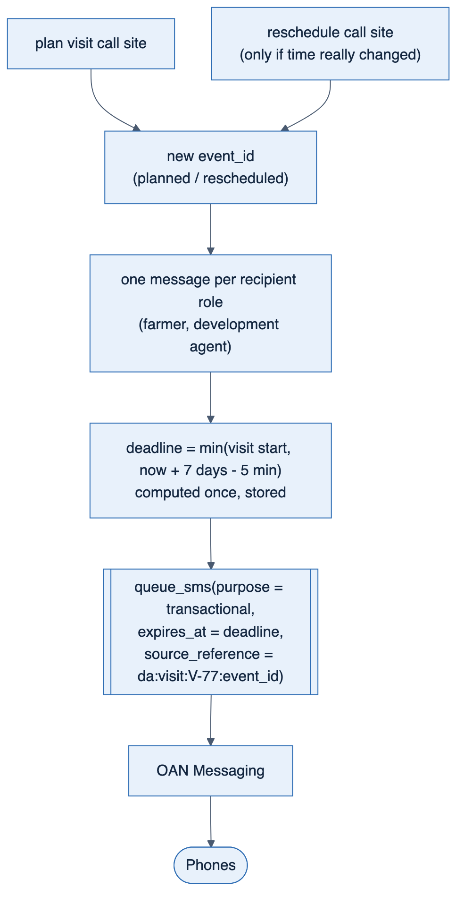

# 13 DA Services: visit planned and rescheduled

| | |
|---|---|
| **Pattern** | Frappe connector ([03](03-frappe-connector.md)) |
| **Status** | Designed; **not built**. There is **no DA SMS sender today**. |
| **Stack** | Frappe app `da_services` (requires `oan_auth_service`) |
| **Phones** | Farmer: the registered phone from the beneficiary API (guide 02 §5). Development Agent: from the DA backend roster. |



## 1. What is sent

| Event | When | Recipients (DA chooses) | Expires |
|---|---|---|---|
| `planned` | A visit is first scheduled with a future start | Farmer; assigned development agent | The visit start, capped below the horizon |
| `rescheduled` | The stored scheduled time **actually changes** (old ≠ new, compared in the same transaction) | Same | Same |

Not an event:
* a save that does not change the time;
* a retried API call that re-applies the same time;
* a visit already in the past.

A cancellation SMS is **future scope** unless the DA team defines it.

* Purpose `transactional`.
* `source_reference = da:visit:<visit_id>:<event_id>`. Every reschedule gets a **new
  `event_id`**.
* **Deadline:** `min(visit start, first_submitted_at + 7 days − 5 minutes)`, computed
  **once** and stored. With the connector, `first_submitted_at` is the moment you queue
  the message, so the sketch below uses `now` at the call site; never recompute it on a
  retry. A visit more than 7 days away still notifies now, with the capped
  deadline.

## 2. Integration steps

| # | Step | Owner | Done when |
|---|---|---|---|
| 1 | Install `oan_messaging_connector`; add it to `required_apps` | DA dev | Installed on DA sites |
| 2 | Raise events at the plan and reschedule **call sites**, not in a `doc_events` save hook (that loses event identity, so retries and ordinary saves would send duplicates) | DA dev | Only real plan or reschedule actions create events |
| 3 | A small *DA Visit Notification Event* record (`event_id` UUID4, visit, kind, deadline), unique per event, so a retry never creates a second event | DA dev | Unique constraint on (`event_id`, role) |
| 4 | Compute the capped deadline once and store it; pass it as `expires_at` | DA dev | No recomputation on retry |
| 5 | Before queueing, skip visits that are cancelled or in the past | DA dev | Covered by tests |
| 6 | For each recipient role call `queue_sms(recipient, text, purpose="transactional", source_reference=f"da:visit:{visit}:{event_id}", expires_at=deadline, reference_doctype=…, reference_name=…, event=kind)` | DA dev | Rows created per role |
| 7 | Post-commit dispatch, sweep, polling, stop rules | **Covered by the connector** | — |
| 8 | Write templates per language within one SMS (DA has none today) | DA content | Measured with the longest values |
| 9 | Per-site enable flag = `oan_messaging_enabled`; one sender only | DA and DevOps | Runbook written |
| 10 | OAN operator registers caller `da` (sms, transactional) and issues a token; site config | OAN ops, DevOps | Rows reach Submitted |
| 11 | Acceptance: QA cases DA-01 to DA-12 | QA | Evidence recorded |

## 3. Sketch (not run: the DA repository was not modified)

```python
from datetime import UTC, datetime, timedelta
from oan_messaging_connector.api import queue_sms

def notify_visit(visit, kind, recipients):            # called at the plan / reschedule call site
    now = datetime.now(UTC)
    deadline = min(visit.start_utc, now + timedelta(days=7) - timedelta(minutes=5))
    if deadline <= now or visit.status == "Cancelled":
        return
    event = create_visit_event(visit, kind, deadline)  # stores event_id and deadline once
    for role, phone, text in recipients:               # e.g. ("farmer", ...), ("agent", ...)
        queue_sms(recipient=phone, text=text, purpose="transactional",
                  source_reference=f"da:visit:{visit.name}:{event.event_id}",
                  expires_at=deadline, reference_doctype="DA Visit", reference_name=visit.name,
                  event=f"{kind}:{role}")
```

## 4. Decisions DA owns

* The exact call sites.
* Recipient roles and their phone fields.
* Templates.
* Whether cancellation is a message.
* The cut-over date.
