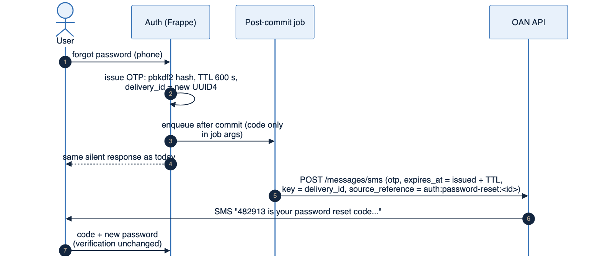

# 14 Auth: password-reset OTP

| | |
|---|---|
| **Pattern** | OTP sender ([04](04-otp-senders.md)), from a Frappe post-commit job (**preferred**, §3). Interim option: the connector's `send_sms` hook (**supported**, §6). |
| **Status** | Designed; **not built**. Reviewed at `34c7306`. |
| **Today** | `_deliver_reset_by_sms` enqueues Frappe core `_send_sms` after commit. The code lives only in the job arguments (no outbox), which is correct and stays that way. |



## 1. What stays the same

Auth keeps everything except the transport:
* OTP generation and pbkdf2 storage;
* TTL (600 s by default), daily cap and attempt cap;
* verification;
* the template ("{0} is your password reset code. It expires in {1} minutes.");
* the silent response to the requester;
* email reset.

## 2. Why Auth does not use the connector outbox

The connector stores message text on its outbox row. The reset SMS **contains the
code**, and Auth deliberately never stores a code in plain text. So Auth sends from its
own post-commit job, with the text only in the job arguments. It can reuse the
connector's **settings and client** without the outbox (see §4).

## 3. Integration steps

| # | Step | Owner | Done when |
|---|---|---|---|
| 1 | **Issue step:** create `delivery_id` (UUID4), `issued_at`, `otp_expires_at = issued_at + TTL` and an opaque `reset_request_id`; pass them in the job arguments with the phone and the rendered text | Auth dev | Unit test |
| 2 | **Replace the enqueue target:** an Auth-owned OAN send job (`queue="short"`, `enqueue_after_commit=True`) instead of `_send_sms`. Never both. | Auth dev | No `_send_sms` call left on this path |
| 3 | **Configuration gate:** "OAN configured for this site" replaces `_sms_gateway_configured()`; when not configured, no send and an unchanged response | Auth dev | Test with OAN disabled |
| 4 | **Job body:** `purpose="otp"`, `expires_at=otp_expires_at`, key `delivery_id`, `source_reference=f"auth:password-reset:{reset_request_id}"`; retry an uncertain outcome with the same key; never re-issue automatically | Auth dev | AUTH tests |
| 5 | **TTL check:** refuse `password_reset_otp_ttl` above the 30-minute OTP ceiling at settings validation | Auth dev | Validation test |
| 6 | **Recipient format:** OAN accepts only Ethiopian mobiles; decide whether to pre-check before issuing | Auth owners | Decision recorded |
| 7 | **Logging:** only `reset_request_id`, the OAN id and error codes. Never the code or the phone. | Auth dev | Log review |
| 8 | **Credentials per site:** caller per site (`auth-a2c`, `auth-grievance`, …), **proposed**; token from a secret | OAN ops, DevOps | Tokens issued |
| 9 | Acceptance: QA cases AUTH-01 to AUTH-14 | QA | Evidence recorded |

## 4. Sketch of the job (not run: the Auth repository was not modified)

```python
import asyncio
from datetime import datetime
import frappe
from oan_messaging_connector.outbox import _settings  # private today; a public settings()
                                                      # or send_otp_now() is planned (22)
from oan_messaging_connector.vendor.oan_client import (
    ClientConfig, OanClient, OanUncertain, Secret, SmsDelivery)

def send_reset_otp(delivery_id, reset_request_id, phone, text, issued_at, otp_expires_at):
    s = _settings()
    delivery = SmsDelivery(idempotency_key=delivery_id, recipient=phone, text=text,
                           source_reference=f"auth:password-reset:{reset_request_id}",
                           purpose="otp", expires_at=datetime.fromisoformat(otp_expires_at),
                           first_submitted_at=datetime.fromisoformat(issued_at))
    async def go():
        cfg = ClientConfig(base_url=s["base_url"], token=Secret(s["token"]), ca_bundle=s["ca_bundle"])
        async with OanClient(cfg) as client:
            return await client.submit(delivery)
    try:
        sub = asyncio.run(go())
        frappe.logger().info("reset OTP accepted reset_request_id=%s oan_id=%s", reset_request_id, sub.id)
    except OanUncertain as e:              # timeout, 503, connection error (and its
        requeue_later(not_before=e.retry_not_before)   # subclass OanRetryDeferred)
    except ReconciliationRequired:         # guarantee window passed: never resubmit
        frappe.logger().warning("reset OTP needs reconciliation reset_request_id=%s",
                                reset_request_id)
    except OanRejected as e:               # 4xx (includes OanConflict): never retry
        frappe.logger().warning("reset OTP refused reset_request_id=%s code=%s",
                                reset_request_id, e.code)
```

Frappe's `enqueue` does **not** retry a failed job by itself. `requeue_later` (yours)
enqueues the same job with the same arguments after a delay, and stops once
`otp_expires_at` has passed. `retry_not_before` is `None` unless a
gateway sent `Retry-After`; then wait about 30 seconds. Import `ReconciliationRequired`,
`OanRejected` and `OanUncertain` from the same client module.

A shared `send_otp_now()` helper in the connector is a planned follow-up
([22](22-decisions-and-open-items.md)).

## 5. Why the explicit job, not only the hook

Auth already enqueues Frappe's `_send_sms`, so the connector's `send_sms` hook would move
the reset OTP to OAN with no Auth change. It is supported, but it is not the target:

* **Purpose and expiry are per site, not per message.** Auth runs on every module site
  (Grievance, Credit and DA list it in `required_apps`). On a site where the hook also
  carries Grievance notices, the purpose must stay `transactional`, so the reset code is
  sent without OTP priority and with the site's expiry instead of the code's own TTL.
* **No retry with the same key across jobs.** The hook retries an unclear outcome only
  inside the one job; it cannot requeue for later.
* **No OAN id in Auth's log**, so a support question cannot be traced to one message.

The explicit job in §3 and §4 sets `purpose="otp"`, `expires_at` from the code's TTL and
a stable key, and logs the OAN id.

## 6. Interim option: the `send_sms` hook

Details, settings and behaviour: [03 §7](03-frappe-connector.md).

* **No Auth code change.** `_sms_gateway_configured()` returns true once a hook is
  registered, and the reset job calls the hook instead of Frappe's gateway. The code
  stays only in the job arguments; the connector stores nothing.
* **Who registers it.** A `send_sms` line in Auth's own `hooks.py` would turn the hook on
  for **every** site with Auth, including Credit and DA. Register it in the module app
  of the site that wants it (for example Grievance, [12 §6](12-grievance.md)), not in
  Auth.
* **Settings.** On a site where the hook carries only OTPs, set Hook Message Purpose to
  `otp` and the expiry to the code's TTL in minutes (10 for the default 600 s; at most
  30). Otherwise leave `transactional` and 30 minutes.
* **Failures.** When the connector is disabled, not configured, or OAN refuses, the hook
  raises: the job fails with an Error Log entry and no code reaches the user. The
  requester's response does not change, as today.
* Acceptance: QA cases AUTH-H1 and AUTH-H2.

## 7. Telegram linking OTP (new)

The Telegram bot specification v1.1 links a farmer's Telegram account to their Farmer ID
with an OTP to their **registered phone** (from the beneficiary API). Auth issues and
verifies that OTP for the bot's service, using the same OTP sender pattern as the reset:
* `purpose="otp"`, the code's own expiry (at most 30 minutes), a UUID4 key per send;
* `source_reference=f"auth:telegram-link:{link_request_id}"`;
* the code only in the job arguments, stored hashed, never logged.

**Not built.** Open: which Auth site hosts the routes, and the service-client
credentials for the bot's service ([22](22-decisions-and-open-items.md)).

