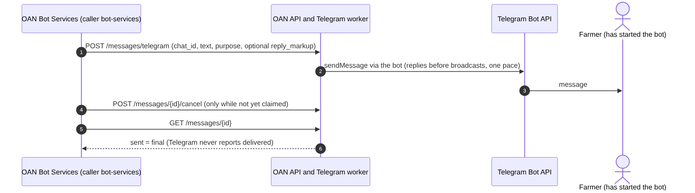

# 16 Telegram

| | |
|---|---|
| **Pattern** | Direct API (`POST /api/v1/messages/telegram`) |
| **Status** | Implemented in OAN (contract 3.4.0). **One caller: OAN Bot Services** (`bot-services`), decided 24 November 2026 (TG-36, TG-37). Built and tested against stubs; not yet run end to end with a fake Telegram; not deployed. |
| **Why** | In this release the OAN Telegram bot does broadcasts plus sign-up and runs without RapidPro: it answers no questions and replies only to sign the farmer up and manage their updates. OAN Bot Services receives the webhook and runs that button conversation; OAN Messaging sends every Telegram message, the bot's replies and the area broadcast copies, and is the only place the bot token is kept. |



## 1. Rules specific to Telegram

* **The farmer must have started the bot first.** A bot cannot message someone who has
  not. OAN Bot Services owns the link between a farmer and their `chat_id`, and marks a
  blocked or deleted chat unreachable.
* **One bot per caller.** The OAN operator maps `bot-services` to the bot, and the bot
  token lives only in OAN Messaging. A request never carries a token, a URL or a parse
  mode.
* Plain text, at most **4096 UTF-16 units**, sent literally (no parse mode).
* **Reply buttons** (contract 3.4.0): optional `reply_markup`, either a keyboard of 1-4
  rows of 1-3 buttons, each 1-30 UTF-16 units, or `remove_keyboard`. Part of the
  idempotency fingerprint; purged with the text.
* **Purposes:** `transactional` (bot replies, claimed before waiting broadcasts), `alert`
  and `broadcast` (area broadcast copies). `otp` is not allowed.
* **Broadcasts need the Telegram switch.** `OAN_MSG_TELEGRAM_BROADCAST_ENABLED` (Helm
  `workerTelegram.broadcastEnabled`, default off) allows purpose `broadcast` on Telegram
  only; SMS broadcasts keep their own switch.
* **Cancel:** `POST /api/v1/messages/{id}/cancel` cancels the caller's own Telegram
  message that no worker has claimed yet (200 `failed`/`cancelled`; 409
  `not_cancellable` once claimed or finished; 404 for someone else's; 422 for an SMS). OAN
  Bot Services uses it when a farmer turns updates off or stops.
* **One pace for the bot:** `OAN_MSG_TELEGRAM_RATE_PER_SECOND`, default 20; Telegram's
  `retry_after` is honoured.
* **`sent` is final.** Telegram never reports `delivered`, so do not show "Delivered".
* **No automatic SMS fallback.** The SMS copy of an area broadcast is sent separately by
  the DA backend, with its own keys (TG-45).
* **No second caller on the same bot** without the bot owners' agreement: two senders on
  one bot would share Telegram's rate limits and confuse the farmer's chat.

## 2. Integration steps

| # | Step | Owner | Done when |
|---|---|---|---|
| 1 | Name the producing service and its owner | Product | **Closed:** OAN Bot Services |
| 2 | Chat-link state (active, stopped, unreachable) and how it is refreshed | OAN Bot Services | Done (`oan_bot_services/`; channels spec §5.4, §6.8.1) |
| 3 | Outbox record per message with a stable key; re-check before submit; cancel waiting copies; poll until `sent` or `failed` | OAN Bot Services | Done (`oan_bot_services/broadcasts.py`, `jobs.py`); tested against stubs |
| 4 | OAN operator registers `bot-services` with channel `telegram`, purposes `transactional,alert,broadcast` and the bot mapping, and issues the token | OAN ops | Done per environment |
| 5 | Set the Telegram broadcast switch for the environment | OAN ops | Pilot setting open (channels spec §8.3) |
| 6 | Acceptance: QA cases TG-01 to TG-19, then the Telegram release gate (channels spec §7.6) | QA | Evidence recorded |

## 3. Request example (test values)

```json
{"chat_id": 900000101, "text": "Choose your language.",
 "source_reference": "bot:3f9c2a:7", "purpose": "transactional",
 "reply_markup": {"keyboard": [["English", "Amharic"]], "resize": true}}
```

The bot's own texts are keys in `telegram/contracts/text-keys.yaml`; the caller contract
is `telegram/contracts/oan-messaging-caller.md`.
